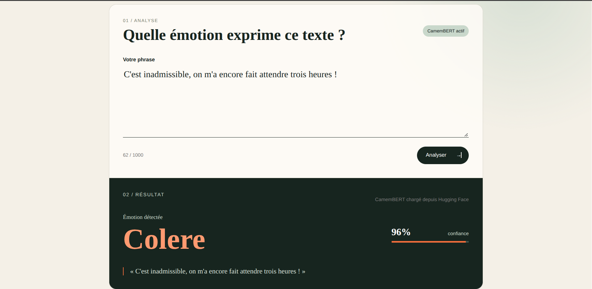

# EmoFR

EmoFR est une application web permettant d'analyser l'émotion exprimée dans une phrase en français.

Elle utilise le modèle **CamemBERT fine-tuné** `AbdelkarimAouad/camembert-emofr`, chargé directement depuis Hugging Face en mémoire avec Transformers et Torch.



## Fonctionnalités

- Analyse d'une phrase en français
- Affichage de l'émotion détectée
- Affichage du niveau de confiance
- Chargement direct du modèle Hugging Face
- Interface responsive en HTML, CSS et JavaScript
- API Flask pour la prédiction

## Emotions prises en charge

- Joie
- Tristesse
- Colère
- Peur
- Surprise
- Dégoût

## Prérequis

- Python 3.12
- Un jeton Hugging Face autorisé à accéder au modèle privé
- Connexion Internet au premier lancement pour télécharger le modèle

## Installation

Créer et activer l'environnement virtuel :

```bash
python3 -m venv .venv
source .venv/bin/activate
```

Installer les dépendances :

```bash
pip install -r requirements.txt
```

## Configuration

Le modèle privé utilise un jeton Hugging Face. Créez un fichier `.env` à la racine du projet :

```text
HF_TOKEN=hf_votre_token
```

Vous pouvez également exporter la variable dans le terminal :

```bash
export HF_TOKEN="hf_votre_token"
```

Pour utiliser un autre dépôt, ajoutez :

```text
EMOFR_MODEL_REPO=utilisateur/nom-du-modele
```

## Lancement

```bash
python app.py
```

Puis ouvrir :

```text
http://127.0.0.1:5000
```

Le modèle est chargé au démarrage de l'application. Les premières prédictions suivent donc un téléchargement initial du modèle depuis Hugging Face.

## Structure du projet

```text
EmoFR/
├── app.py
├── requirements.txt
├── .env
├── README.md
├── notebooks/
│   └── EmoFR.ipynb
├── templates/
│   └── index.html
├── static/
│   ├── style.css
│   ├── app.js
│   └── emotions.json
└── figures/
    └── interface.png
```

## API de prédiction

Route :

```text
POST /api/predict
```

Corps JSON :

```json
{
  "text": "Je suis vraiment heureux aujourd'hui"
}
```

Réponse :

```json
{
  "text": "Je suis vraiment heureux aujourd'hui",
  "emotion": "joie",
  "confidence": 0.97,
  "method": "CamemBERT chargé depuis Hugging Face",
  "provider": "huggingface-direct"
}
```

## Notebook

L'expérience, l'entraînement et l'analyse des modèles sont documentés dans [notebooks/EmoFR.ipynb](notebooks/EmoFR.ipynb).

Le notebook n'est pas modifié par l'application web.
